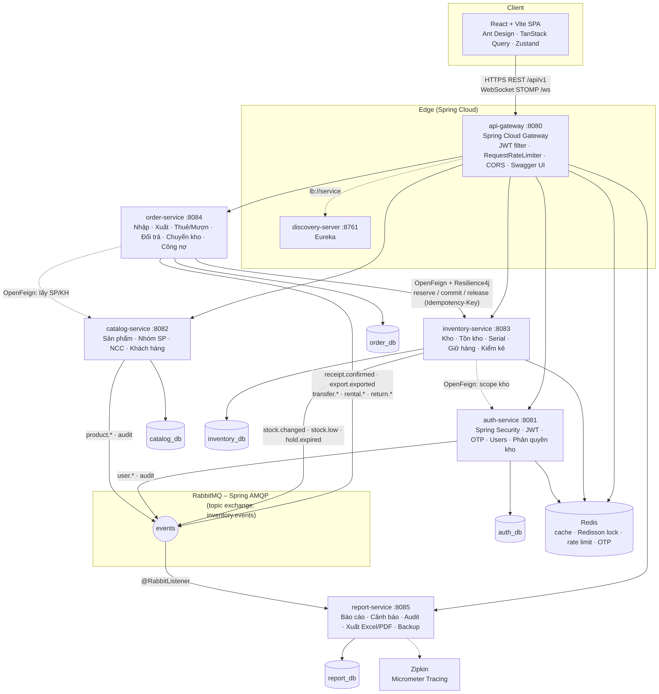
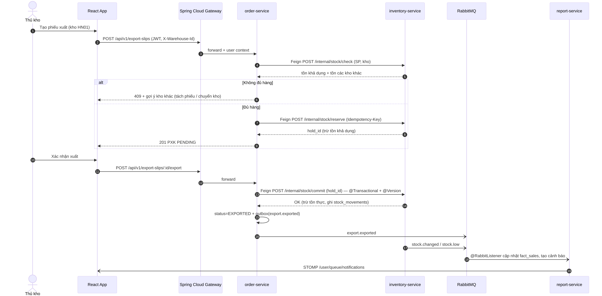
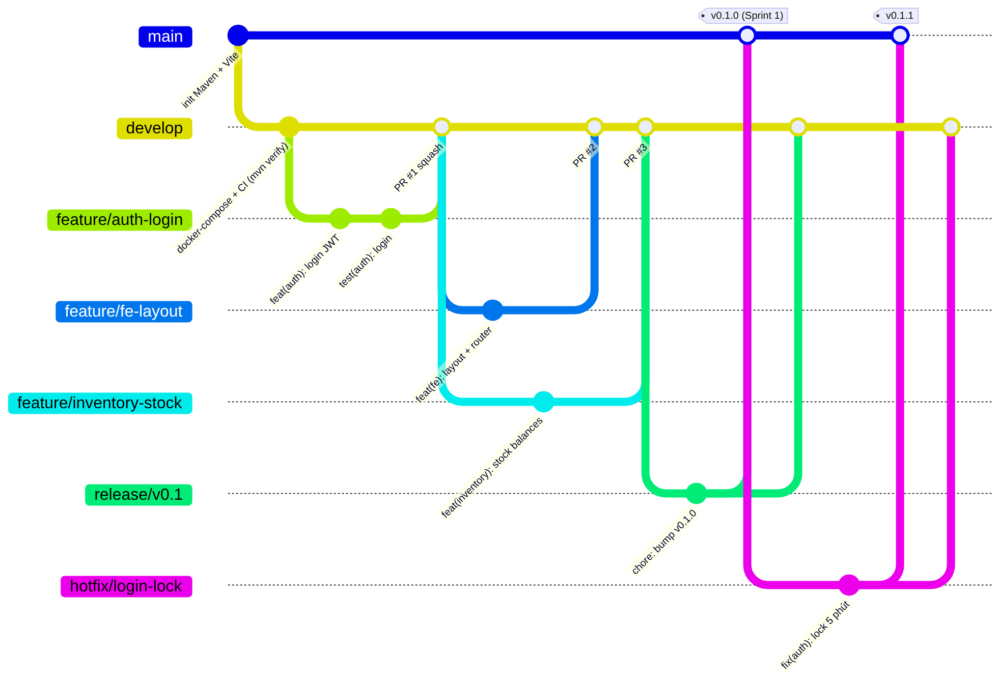

# Đồ án Inventory Microservice (tên tạm) – Thiết kế hệ thống

> Nguồn: SRS TigerNet v1.1 (Google Drive, cập nhật 10/2026). Bản này viết lại cho stack **Java Spring Boot (microservice) + React Vite**, nhóm 3 người (Nhật, Quân: backend · Nghĩa: frontend + Figma), thời gian 2 tháng (26/10/2026 → 25/12/2026).
> Kèm theo: `database/schema.sql`, `diagrams/*.png|svg` (nguồn Mermaid trong `diagrams/mermaid-src/`), `Ke_hoach_Do_an_Inventory_Microservice.xlsx`.
> Cập nhật 26/10/2026: chuyển backend từ NodeJS Express sang Java 21 + Spring Boot 3.3 / Spring Cloud.

## 1. Phạm vi đồ án (MVP 2 tháng)

**Làm (theo SRS):** đăng nhập/JWT/OTP quên mật khẩu, khóa tài khoản 5 lần sai; người dùng & phân quyền theo vai trò + theo kho; danh mục sản phẩm/nhóm/NCC/khách hàng; danh mục kho đa địa điểm; tồn kho theo (Sản phẩm, Kho) và theo serial; nhập kho; xuất kho + gợi ý kho khác khi thiếu + tách phiếu; giữ hàng (hold) có hạn; cho thuê/cho mượn + trả ở kho khác + tính phạt; đổi/trả theo bảng phí 3.8; chuyển kho đủ 8 trạng thái + sai lệch; kiểm kê + điều chỉnh; thanh toán/công nợ; cảnh báo realtime; báo cáo (tồn, nhập/xuất, doanh thu theo SP/KH/NV/kho, cho thuê, công nợ, đa kho) + xuất Excel/PDF; audit log; backup tự động (mysqldump cron).

**Không làm / để "stretch":** app Flutter mobile (thay bằng web responsive), offline mode, vị trí lưu trữ Khu-Kệ-Ô (Phase 2 – làm nếu dư thời gian), đăng nhập Google OAuth, xuất .doc/.xml.

## 2. Thay đổi so với SRS gốc

| SRS gốc | Thiết kế mới | Lý do |
|---|---|---|
| Spring Boot monolith + Flutter | Spring Boot **microservice** (Spring Cloud) + React Vite | Yêu cầu đồ án |
| 1 database MySQL tập trung | 5 database (database-per-service) trên cùng 1 MySQL server, migration bằng Flyway | Đúng mô hình microservice, vẫn dễ chạy bằng docker-compose |
| Bảng `Inventory` gộp cả tồn kho + bán + thanh toán | Tách: `stock_balances`, `stock_items`, `stock_movements` (inventory) và chứng từ `goods_receipts`, `export_slips`, `rental_contracts`… (order) | Một dòng hàng không thể vừa là tồn vừa là hóa đơn; chuẩn hóa để báo cáo đúng |
| Bảng tra cứu `Transaction_Types`, `VAT_Options`, `Payment_Statuses` | ENUM (Java enum + `@Enumerated(STRING)`) | Ít thay đổi, bớt join chéo service |
| FK giữa mọi bảng | FK chỉ trong 1 service; chéo service lưu ID + snapshot JSON (tên, MST…) | Service độc lập, chứng từ in ra không đổi khi danh mục đổi |
| `Hold_By_User_ID`, `Hold_Until` trên Inventory | Bảng `stock_holds` | Giữ được hàng không serial theo số lượng, có lịch sử |
| Chưa có kiểm kê, đổi trả, thanh toán dạng bảng | `stocktakes`, `sales_returns`, `rental_returns`, `payments`, `transfer_discrepancies` | SRS mô tả nghiệp vụ nhưng thiếu bảng |
| — | `outbox_events`, `processed_events`, `processed_requests` | Gửi event tin cậy & chống xử lý trùng |
| View `View_Stock_By_Warehouse`… | Endpoint + read model ở report-service (`fact_sales`, `stock_snapshots`) | Không join chéo database được |

## 3. Kiến trúc



| Module | Port | Database | Trách nhiệm |
|---|---|---|---|
| discovery-server | 8761 | – | Eureka – đăng ký & tìm service |
| api-gateway | 8080 | – | Spring Cloud Gateway: route `/api/v1/**` → `lb://<service>`, filter xác thực JWT, `RequestRateLimiter` (Redis) theo user, CORS, gộp Swagger UI, route WebSocket |
| auth-service | 8081 | auth_db | Spring Security, đăng nhập, refresh token, OTP, user, role/permission, gán kho, cấu hình hệ thống |
| catalog-service | 8082 | catalog_db | Sản phẩm, nhóm SP, nhà cung cấp, khách hàng, upload ảnh |
| inventory-service | 8083 | inventory_db | Kho, tồn kho, serial, giữ hàng, nhật ký biến động, kiểm kê. **Nguồn sự thật duy nhất về tồn** |
| order-service | 8084 | order_db | Phiếu nhập, xuất, thuê/mượn, trả, đổi trả, chuyển kho, thanh toán, công nợ, bảo hành |
| report-service | 8085 | report_db | Báo cáo, dashboard, cảnh báo (`@Scheduled` + event), WebSocket STOMP, audit log, xuất Excel/PDF, backup |

**Giao tiếp**
- *Đồng bộ (OpenFeign + Resilience4j retry/circuit breaker, header `X-Internal-Key` + `Idempotency-Key`)*: order → inventory (`check`, `reserve`, `commit`, `release`, `receive`, `transfer-in`, `reverse`), order → catalog (lấy SP/KH theo danh sách ID).
- *Bất đồng bộ (RabbitMQ, Spring AMQP, topic exchange `inventory.events`)*: `receipt.confirmed`, `export.exported`, `rental.created|returned`, `return.completed`, `transfer.submitted|shipped|received|discrepancy`, `stock.changed`, `stock.low`, `hold.expired`, `audit.log` → report-service xử lý bằng `@RabbitListener`. Order-service ghi `outbox_events` trong cùng `@Transactional`, job `@Scheduled` đẩy lên RabbitMQ.
- *Nhất quán tồn kho (SRS 3.10.7)*: mọi thay đổi tồn trong inventory-service chạy trong `@Transactional`, đọc `StockBalance` bằng `@Lock(PESSIMISTIC_WRITE)` và có `@Version`; thao tác serial đồng thời khóa thêm bằng Redisson (`lock:stock:{productId}:{warehouseId}`) → kịch bản 8.5#5 chỉ 1 giao dịch thành công.
- *Phân quyền theo kho (SRS 3.10.3, 8.3)*: gateway xác thực JWT (`userId`, `role`, `warehouseIds`, `allWarehouses`) và chuyển xuống service qua header; trong service, `common-lib` dựng `UserContext` và annotation `@RequireWarehouseAccess(write = true)` (Spring AOP) kiểm tra kho của request ở **server**; quyền theo vai trò dùng `@PreAuthorize("hasRole('MANAGER')")`.
- *Quan sát*: Spring Boot Actuator (`/actuator/health`), Micrometer Tracing + Zipkin (traceId xuyên service), log JSON.

Luồng tạo & xác nhận phiếu xuất:



## 4. Database (viết lại)

DDL đầy đủ: [`database/schema.sql`](database/schema.sql) – MySQL 8, 5 database, 47 bảng, kèm seed vai trò và cấu hình. Mỗi service tách phần của mình thành Flyway `V1__init.sql`, `V2__seed.sql` và chạy Hibernate với `ddl-auto=validate`.

| Database | Bảng | ERD |
|---|---|---|
| auth_db | roles, permissions, role_permissions, users, user_warehouses, refresh_tokens, password_otps, login_histories, system_settings | `diagrams/02-erd-auth-service.png` |
| catalog_db | product_groups, products, suppliers, customers | `diagrams/03-erd-catalog-service.png` |
| inventory_db | warehouses, warehouse_locations, product_warehouse_settings, stock_balances, stock_items, stock_holds, stock_movements, stocktakes, stocktake_items, processed_requests | `diagrams/04-erd-inventory-service.png` |
| order_db | doc_sequences, goods_receipts(+items), export_slips(+items), rental_contracts, rental_items, rental_returns(+items), sales_returns(+items), stock_transfers(+items), transfer_discrepancies, payments, outbox_events | `diagrams/05-erd-order-service.png` |
| report_db | notifications, audit_logs, fact_sales, fact_stock_movements, stock_snapshots, export_jobs, backup_logs, processed_events | `diagrams/06-erd-report-service.png` |

Công thức tồn (SRS 3.10.4): `available = qty_on_hand − qty_hold − qty_damaged`; tổng hệ thống = Σ `qty_on_hand` + Σ hàng `IN_TRANSIT`.

**Mapping JPA:** ENUM → `@Enumerated(EnumType.STRING)`; cột JSON (serials, snapshot) → `@JdbcTypeCode(SqlTypes.JSON)`; `version` → `@Version`; `created_at/updated_at` → `@CreationTimestamp/@UpdateTimestamp`; cột mã hóa (STK, CCCD) → `AttributeConverter` AES-256; quan hệ chéo service chỉ là trường `Long`, không dùng `@ManyToOne`.

## 5. Cấu trúc dự án

Theo đúng thư mục sẵn có trên máy: `D:\MicroInvent\{Backend, Frontend, Docs}`.

```
MicroInvent/
├── .github/
│   ├── workflows/backend-ci.yml    # mvn verify theo module bị đổi (Spotless, Checkstyle, JUnit, Testcontainers)
│   ├── workflows/frontend-ci.yml   # npm ci → lint → test → build
│   ├── pull_request_template.md
│   └── CODEOWNERS
├── Docs/                           # tài liệu này, SRS, ERD, sơ đồ, kế hoạch xlsx
├── Backend/
│   ├── pom.xml                     # parent POM: Java 21, Spring Boot 3.3, Spring Cloud BOM, modules
│   ├── docker-compose.yml          # mysql, redis, rabbitmq, mailhog, zipkin + 7 module
│   ├── .env.example
│   ├── infra/
│   │   ├── mysql/init/01-create-databases.sql
│   │   └── rabbitmq/definitions.json
│   ├── common-lib/                 # thư viện dùng chung (jar)
│   │   └── src/main/java/com/microinvent/common/
│   │       ├── api/ ApiResponse.java · PageResponse.java · ErrorCode.java
│   │       ├── exception/ BusinessException.java · GlobalExceptionHandler.java (@RestControllerAdvice)
│   │       ├── security/ JwtAuthFilter.java · UserContext.java · RequireWarehouseAccess.java · WarehouseAccessAspect.java
│   │       ├── messaging/ AmqpConfig.java · DomainEvent.java · EventTypes.java
│   │       ├── feign/ InternalAuthInterceptor.java (X-Internal-Key, traceId)
│   │       └── idempotency/ IdempotencyService.java
│   ├── discovery-server/           # @EnableEurekaServer
│   ├── api-gateway/                # Spring Cloud Gateway: application.yml (routes), JwtGatewayFilter, RateLimiterConfig, CorsConfig
│   ├── auth-service/
│   │   ├── pom.xml · Dockerfile
│   │   └── src/
│   │       ├── main/java/com/microinvent/auth/
│   │       │   ├── AuthServiceApplication.java
│   │       │   ├── config/        SecurityConfig.java · MailConfig.java · RedisConfig.java
│   │       │   ├── controller/    AuthController.java · UserController.java · SettingController.java
│   │       │   ├── service/       AuthService.java · UserService.java · OtpService.java · JwtService.java
│   │       │   ├── repository/    UserRepository.java · RoleRepository.java ...
│   │       │   ├── entity/        User.java · Role.java · UserWarehouse.java ...
│   │       │   ├── dto/           request/ · response/  (record + Bean Validation)
│   │       │   ├── mapper/        UserMapper.java (MapStruct)
│   │       │   └── event/         UserEventPublisher.java
│   │       ├── main/resources/    application.yml · application-dev.yml · db/migration/V1__init.sql, V2__seed.sql
│   │       └── test/java/...      unit (Mockito) · integration (@SpringBootTest + Testcontainers)
│   ├── catalog-service/            # controller: ProductGroup, Product, Supplier, Customer, Internal
│   ├── inventory-service/          # controller: Warehouse, Stock, Hold, Stocktake, InternalStock; job: HoldExpiryJob
│   ├── order-service/              # controller: GoodsReceipt, ExportSlip, Rental, SalesReturn, Transfer, Payment, Debt, Warranty
│   │                               # client/ InventoryClient, CatalogClient (OpenFeign) · job/ OutboxPublisherJob
│   └── report-service/             # controller: Dashboard, Report, Export, Notification, AuditLog, Backup
│                                   # listener/ (@RabbitListener) · job/ AlertJob, SnapshotJob, BackupJob · websocket/ StompConfig
└── Frontend/                       # React 18 + Vite
    ├── src/
    │   ├── main.jsx · App.jsx
    │   ├── app/ router.jsx · queryClient.js · store/ (authStore, warehouseStore, themeStore)
    │   ├── api/ axiosClient.js (interceptor refresh token, X-Warehouse-Id) · stomp.js (@stomp/stompjs)
    │   ├── components/ ui/ (DataTable, FormModal, StatusTag, MoneyInput, SerialScanner...)
    │   │               layout/ (AppHeader, Sidebar, WarehouseSelector, NotificationBell)
    │   ├── features/   auth · dashboard · products · partners · warehouses · receipts · exports
    │   │               holds · transfers · rentals · returns · stocktakes · payments · reports
    │   │               notifications · users · settings · audit
    │   │               (mỗi feature: pages/ · components/ · hooks/ · <feature>.api.js)
    │   ├── layouts/ MainLayout.jsx · AuthLayout.jsx
    │   ├── routes/ ProtectedRoute.jsx · RoleGuard.jsx
    │   ├── styles/ tokens.css (lấy từ Figma) · theme.js (light/dark)
    │   ├── utils/ format.js (tiền VND, ngày) · constants.js (enum trạng thái)
    │   └── locales/ vi.json
    ├── vite.config.js (proxy /api → :8080) · .env.example (VITE_API_URL) · Dockerfile
    └── package.json
```

**Thư viện đề xuất**
- Backend: Java 21, Spring Boot 3.3 (Web, Validation, Data JPA, Security, Actuator, Mail, AMQP, WebSocket, Data Redis), Spring Cloud 2023.x (Gateway, Netflix Eureka, OpenFeign, Circuit Breaker Resilience4j), Flyway, MySQL Connector/J, jjwt, Redisson, Lombok, MapStruct, springdoc-openapi, Apache POI, OpenPDF (hoặc JasperReports), ShedLock, Micrometer Tracing + Zipkin, JUnit 5, Mockito, Testcontainers, Spotless + Checkstyle.
- Frontend: React 18, Vite, React Router 6, Ant Design 5 (bảng, form, locale vi), TanStack Query, Zustand, Axios, React Hook Form + Zod, Recharts, dayjs, @stomp/stompjs + sockjs-client, Vitest + Testing Library, MSW (mock API).

**Quy ước API:** prefix `/api/v1`, JSON `{ success, data, meta, error: { code, message, details } }`, phân trang `?page=&size=&sort=field,asc` (chuẩn Spring Data), header `X-Warehouse-Id` cho kho đang làm việc, mã lỗi nghiệp vụ dạng `STOCK_NOT_ENOUGH`, `WAREHOUSE_FORBIDDEN`. Swagger UI mỗi service sinh tự động bằng springdoc và gộp ở gateway. Danh sách đầy đủ 157 endpoint ở các sheet **API - Nhật**, **API - Quân**, **API - Nghĩa (FE)** trong file xlsx.

## 6. Git workflow



- **Nhánh:** `main` (bản demo ổn định, gắn tag cuối mỗi sprint) · `develop` (tích hợp) · `feature/<scope>-<mô-tả>` · `fix/<scope>-<mô-tả>` · `release/vX.Y` · `hotfix/<mô-tả>`. `scope` = `auth|catalog|inventory|order|report|gateway|common|fe|infra|docs`.
- **Commit:** Conventional Commits – `feat(inventory): giữ hàng có thời hạn`, `fix(order): …`, `test`, `docs`, `chore`, `refactor`. Tên PR được GitHub Action kiểm tra theo chuẩn này.
- **Pull Request:** vào `develop`, nhỏ (< 400 dòng), có mô tả + link issue + ảnh màn hình (frontend). CI xanh + ≥ 1 approve (Nhật ↔ Quân review chéo; PR frontend do Nhật hoặc Quân review phần gọi API; PR đổi API contract phải có Nghĩa approve). **Squash merge**, xóa nhánh sau merge.
- **Trước khi mở PR:** backend chạy `mvn -pl <module> -am verify`; frontend chạy `npm run lint && npm test`.
- **Bảo vệ nhánh:** cấm push thẳng `main`/`develop`; bắt buộc CI + review.
- **Release:** cuối mỗi sprint (2 tuần) tạo `release/v0.N` → test → merge `main` + tag `v0.N.0` → merge ngược `develop`. Hotfix từ `main`, merge vào cả `main` và `develop`.
- **Quản lý việc:** GitHub Projects (Backlog → To do → In progress → Review → Done); mỗi task trong sheet "Kế hoạch & Chia việc" là 1 issue, đặt label service + sprint.

## 7. Định nghĩa hoàn thành (DoD)

Code đã review & merge vào `develop`; có test (JUnit + Testcontainers, ≥ 60% coverage cho logic tồn kho/chứng từ, đo bằng JaCoCo); Swagger cập nhật; chạy được bằng `docker compose up`; màn hình frontend khớp Figma và responsive; kịch bản 8.5 của SRS liên quan đã pass.
